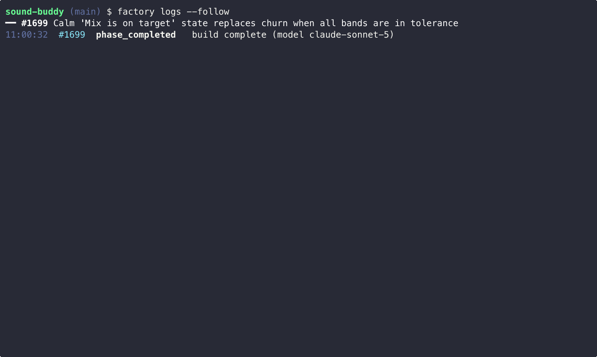

# On PAR Dev's Software Factory

On PAR Dev's Software Factory is a local CLI that takes a GitHub issue through plan, build and check with AI agents, then opens a ready-for-review PR. You decide what merges.

Built in TypeScript. Routes work across Claude and Codex, with experimental local models through Ollama, and logs cost per task.



For an example of its output, see [#2288](https://github.com/on-par/software-factory/pull/2288): the factory planned and built issue #2269 (`factory cost --json`), ran its checkers (7 pass, 1 rework round), opened the PR with an evidence pack comment, and CI passed. Merging was a separate step.

## Status

What works today (this table matches the code on main):

| Feature                                               | Status     | Notes                                                                                                            |
| ----------------------------------------------------- | ---------- | ---------------------------------------------------------------------------------------------------------------- |
| `factory ship` pipeline (PLAN → BUILD → CHECK → SHIP) | ✅ Working | Covered by an end-to-end pipeline integration test                                                               |
| `factory triage` (queue from open issues)             | ✅ Working |                                                                                                                  |
| `factory run` (parallel lanes)                        | ✅ Working | Merges are serialized per lane via a merge-wait step                                                             |
| `factory land` / auto-merge                           | ✅ Working | Off by default. Turn on with `FACTORY_MERGE=1`, `run.merge.auto: true` or `--auto-merge`; see [Safety](#safety). |
| `factory supervise` (multi-window unattended runs)    | ✅ Working | Waits for usage headroom, runs the queue, repeats until drained                                                  |
| Cost tracking (`factory cost`)                        | ✅ Working | Per-task tokens and cost logged to `.factory/state/costs.jsonl`                                                  |

The full matrix, including model harnesses, prompt evals and experimental local (Ollama) models, is in [docs/status.md](docs/status.md).

## Monorepo structure

An npm-workspaces monorepo:

```
packages/
├── adr-kit/          @on-par/adr-kit            pure ADR kernel (zero deps)
├── cli/              @on-par/factory-cli        the `factory` command
├── config/           @on-par/factory-config     typed defaults + constitutions in TypeScript (zero deps)
├── contracts/        @on-par/contracts          shared zod schemas (Issue/Epic/Story/Design)
├── core/             @on-par/factory-core       engine: router, phases, checkers
├── repo-context/     @on-par/repo-context       read-only repo reader port (zero deps)
└── tui/              @on-par/factory-tui        read-only Ink TUI for a live run
```

For the dependency graph and per-package detail, see [docs/architecture.md](docs/architecture.md). To contribute, see [CONTRIBUTING.md](CONTRIBUTING.md) and the rules in [AGENTS.md](AGENTS.md).

## Quick start

**Prerequisites**

- Node.js ≥ 24 and `git`. On older Node versions, the CLI stops and tells you which version it needs. Commits need a git identity: set it globally or with repo-local `git config`.
- One supported coding agent CLI (see [docs/agents.md](docs/agents.md)) on your PATH and signed in. That guide covers install and sign-in for each agent.
- `gh`, signed in with `gh auth login`. It also supplies the GitHub token (`GITHUB_TOKEN` or `GH_TOKEN` override it). `factory doctor` checks all of this and prints a fix for anything missing.
- Optional: `ollama` for experimental local models.

Before you start, read [Safety](#safety): the factory runs agents with permission prompts off.

**Step 1: Install**

```bash
npm install -g @on-par/factory-cli   # Requires Node.js 24 or newer
factory --version
factory doctor                       # run this before you continue
```

**Step 2: Point it at your repo**

```bash
cd /path/to/your/repo        # any git repo with a GitHub remote and open issues
factory init                 # creates .factory/ with the default-code constitution
```

Commit `.factory/config.yaml` and `.factory/constitution.md` so every clone shares your standards. Only `.factory/state/` is ignored (via `.factory/.gitignore`). For other constitutions, see [Constitutions](#constitutions).

**Step 3: Triage, then ship**

```bash
factory triage               # a model proposes an ordered queue from your open issues
factory triage accept        # promotes the proposal to the queue
factory ship 42              # PLAN → BUILD → CHECK → SHIP one issue
```

While SHIP waits for CI, a PR with no checks reported yet counts as pending. If the CI watch itself fails (for example a GitHub API error), CI counts as unknown: SHIP fails with `CI unknown`, never marks the PR ready, and the run parks `fail`. `factory ship` ends at a green, ready-for-review PR. Merging stays with you: merge it, or run `factory land <N>`. `factory run` processes the whole queue in parallel lanes.

## GitHub Actions

You can also run one factory command (`run-issue <n>`, `ship <n>` or `doctor`) on a GitHub-hosted runner. Call the reusable workflow from your own repo, pinned to a release tag, and pass your own secrets (`FACTORY_GITHUB_TOKEN` plus the selected provider's key):

```yaml
uses: on-par/software-factory/.github/workflows/factory-run.yml@v0.9.32
```

The full caller, inputs, providers and secrets are in [docs/runbooks/github-actions-run.md](docs/runbooks/github-actions-run.md).

## Safety

To run unattended, the factory starts agent CLIs with their permission prompts turned off:

- Claude Code runs as `claude -p ... --permission-mode bypassPermissions` (the same mode as `--dangerously-skip-permissions`).
- Codex runs as `codex exec ... -c approval_policy=never` with `--sandbox danger-full-access` by default, like Claude. Set `sandbox.codexSandbox: workspace-write` to opt in to Codex's own sandbox; under it, tasks listed in `sandbox.codexFullAccessTasks` still use `--sandbox danger-full-access` and are logged.

Each build runs in a separate git worktree (under `~/.factory/worktrees/<owner>/<repo>/` on a `factory/` branch; set `worktree.parent` to move it and `--branch-prefix` to change the prefix), never in your main checkout. Where available, agent runs are wrapped in an OS sandbox (`sandbox-exec` on macOS, `firejail` on Linux). The sandbox denies agent reads of `~/.ssh`, `~/.aws`, `~/.gnupg` and `~/.config/gh`. The files agents need to sign in stay readable: `~/.claude`, `~/.claude.json`, a `CLAUDE_CONFIG_DIR` profile, `~/.codex` and the macOS keychain. git over ssh, gpg signing and `gh` therefore do not work inside the sandbox. `factory doctor` warns when no sandbox runtime is found; its `codex installed` line then reports the preflight result: Codex runs without its own sandbox (`--sandbox danger-full-access`) by default. To opt in to Codex's `--sandbox workspace-write` sandbox, set `sandbox.codexSandbox: workspace-write`; under it, list tasks under `sandbox.codexFullAccessTasks` to grant full access. The agents still run as you, with your file permissions and your GitHub token, and builds run the target repo's tests and install its dependencies. Only point the factory at repos and issues you trust. Which hosts agents may reach, the registry hosts pre-allowed per ecosystem, and telemetry handling are in [docs/egress.md](docs/egress.md).

The factory never merges by default. `factory ship` and `factory run-issue` never merge unless you pass `--merge` to `run-issue` or `run-brief`; otherwise they stop at the PR, which is marked ready for review once CI passes. `factory run` and `factory supervise` merge only if you turn auto-merge on (`FACTORY_MERGE=1`, `run.merge.auto: true`, or `--auto-merge`). The GitHub Actions wrapper (`factory-run.yml`) sets `FACTORY_MERGE=1` and runs `factory land <N>` after a successful `run-issue` or `ship`; see [docs/runbooks/github-actions-run.md](docs/runbooks/github-actions-run.md#merging). `FACTORY_MERGE_ADMIN=1` lets the token merge through unmet branch protection; set it only when you mean to. Full rules: [docs/config.example.yaml](docs/config.example.yaml).

To report a vulnerability, see [SECURITY.md](SECURITY.md).

## Configuration

`factory init` writes a minimal `.factory/config.yaml`:

```yaml
version: 2
```

Every other key is optional. `pr.footer` defaults to `This PR was made by Software Factory`; set a non-empty string to replace it verbatim, or `""` to remove the footer and its separator. It supports no templating or token substitution. [`docs/config.example.yaml`](docs/config.example.yaml) lists each key the factory reads, with its default and what it does. It is generated from the config schemas (`npm run config-example`) and a test fails when it drifts, so it matches the code. Copy only the keys you want to change (comments included) into `.factory/config.yaml`; `.factory/config.json` is still read for existing repos, and `factory migrate --to-yaml` converts it. `factory status --kpis` prints the effective config. A host such as a disposable container can override the config and constitution for one run without writing into the checkout: see [docs/runbooks/config-overrides.md](docs/runbooks/config-overrides.md).

**Tracker.** The `tracker` key picks the ticket tracker per repo: `kind` is `github` (default) or `linear`. A `linear` block holds `teamKey`, `projects` (Linear project name or id → `owner/repo`), `readyLabel` (default `factory:ready`), `laneLabelGroup` (default `lane`) and `states.ready` / `states.inProgress` / `states.parked` (default `Todo` / `In Progress` / `Todo`). The API key comes only from the `LINEAR_API_KEY` environment variable, never from config. `factory doctor` checks the key and names any project with ready issues but no repo mapping. `factory run`, `factory supervise` and `factory status` read the queue from Linear; a Linear run's branch, PR title and body carry the issue key (`Fixes KEY` on the final slice, `Part of KEY` before it, so Linear's GitHub integration moves the issue), its park, environment-failure and slice-plan comments go to the Linear issue (a failed comment only warns), the no-auto-merge hold reads the issue's Linear labels, and KPIs count Linear keys; building Linear issues in lanes comes in a later slice of #3872.

## Updating

```bash
npm install -g @on-par/factory-cli@latest   # Requires Node.js 24 or newer
factory self-update --check                 # is a newer release on npm? (0.9.3 and later)
factory self-update --to <version>          # install that exact stable version (0.9.6 and later)
```

`factory self-update --to` installs the version next to the running Node, runs `factory doctor`, restarts factoryd, and rolls back if the install or doctor fails. factoryd installed from npm runs the same update on its own when a new stable release appears. Update modes, opting out, and manual rollback are in [docs/ops/updating.md](docs/ops/updating.md). Release notes are in [CHANGELOG.md](CHANGELOG.md).

To run one issue in a disposable container (Foreman on Cloudflare Containers, CI jobs), use the published `ghcr.io/on-par/factory-job` image and `factory job`; see [docs/ops/factory-job-image.md](docs/ops/factory-job-image.md).

The `version` fields in this repo's `package.json` files stay at the last committed version (0.9.32). The publish job writes the release or prerelease version at build time and never commits it, so use `factory --version` or `npm view @on-par/factory-cli dist-tags` to see real versions.

## CLI commands

The most-used commands, by the group `factory --help` lists them under. Run `factory --help` for the full, current list.

```bash
# Run work
factory ship <N>                    Plan → build → check one issue and open a ready-for-review PR; never merges
factory respond <PR>                Run a feedback round on a factory PR: triage trusted feedback, rework or re-plan, push, reply, resolve, re-request review
factory run-issue <N>               Like ship, but loads the issue first and exits 2 if it cannot be found
factory run-issue <N> --merge        After SHIP, wait for CI and land the PR through the run merge gates; exits 0 merged, 10 held, 11 CI failed, 12 timed out, 13 land failed, 14 land deferred (base kept moving), 1 parked before a PR
factory run-issue <N> --in-place   Build in the current clean checkout, no worktree (disposable containers)
factory run-issue <N> --json       Print the final run result as one JSON line on stdout (schemaVersion 2); progress goes to stderr
factory run-issue <N> --export D   Copy the run's state, events and cost records into D on any exit path (also run-brief, ship)
factory run-issue <N> --stack        Build an oversized <N> as a stacked PR set in one run (the size gate default)
factory run-issue <N> --base-branch <ref>  Start from origin/<ref> and open the PR against <ref> (also ship, run-brief)
factory run-brief a.md b.md --stack   Open the briefs as a PR stack (each on the previous brief's PR head)
factory run-brief big.md --stack       Slice an over-budget brief and build the slices as a PR stack in one run
factory run-issue 42 --stack        Build open same-repo prerequisites in order as a PR stack; otherwise stack an oversized issue's slices
factory run --issue <N>            Carry one issue to merged, closed, parked or awaiting-review (--wait stay|exit, --max-wait; exits 0, 1, 15, 16)
factory run                         Claim queued issues and ship them, lanes in parallel; merges only when auto-merge is on
factory supervise [--now]           Unattended loop: wait for usage headroom, run the queue, repeat until it is empty
factory land <N>                    Squash-merge the issue's open PR once CI is green, then remove its worktree
factory stop / factory resume       Halt lanes after their current issue / clear the stop
factory resume N --from check       Re-run CHECK on a kept build; refuses if the base moved
factory stop|resume --json         One JSON object: action, repo, stopFlag {before, after}; idempotent

# Setup
factory init                        Set up .factory/ in this repo and check model reachability
factory doctor                      Check your environment (git, coding agent CLI, gh auth, GitHub token, npm, sandbox)
factory constitution --product <p>  Seed .factory/constitution.md from a bundled example constitution
factory constitution --checkers     List every built-in checker
factory models [--doctor]           List models with tiers, cost, and availability; --doctor probes provider CLIs

# Queue
factory triage [--product <p>]      Have a model propose a queue into .factory/state/queue.proposed
factory queue add <lane> <N...>     Queue GitHub issues into a lane (factory:queued labels)
factory check <N> [--json] [--no-judge] [--rejudge] [--deep]
                                    Read-only pre-flight: model readiness verdict with its questions or assumptions, plus advisory fields and size (alias: ready)
factory draft [--text <idea> | --file <path>] [--json]
                                    Draft an issue from a free-text idea (never filed)

# Observe
factory status                      Show active runs, the GitHub queue, provider health, and recent events
factory status --json               One JSON object: STOP flag, active claims, providers and alerts, disk, update state (--kpis ignored)
factory logs [--follow] [--json] [--issue <n>] [--limit <n>] [--since <cursor>]
                                    Print pipeline events (--limit/--since read only part of the log)
factory cost [--issue <n>] [--since <iso>] [--limit <n>] [--json]  Show recorded model spend by model; --since scopes rows and totals, --limit caps rows only
factory usage                       Report 5-hour subscription usage
```

`factory check` exits 0 when the verdict is ready or ready-with-assumptions, 1 when it is not-ready, 2 on a judge error, and 3 when it would split. `--no-judge` restores the free heading check (1 = missing fields).

`factory draft` exits 0 when the draft is factory-ready, 1 when it is not, 2 on a model or input error, and 3 when it would split.

### Size gate: stack by default

Oversized issues stack by default: `factory run-issue <N>` (or `--stack`) ships an oversized issue as stacked slice PRs. `run-issue --run-children` was removed and exits 2. `--size-gate file|slice` and `sizeGate.mode: file|slice` are deprecated aliases for stack that print one warning naming `--stack`. `--size-gate` accepts `stack` or `off`; `off` skips both gates. An unknown `sizeGate.mode` value (case matters: `Off` is unknown) runs as stack with a warning and a ⚠️ `factory doctor` row (#3850).

## Root npm scripts

| Script                                                            | What it does                                                                                                                                                                             | Runs in                                                                   |
| ----------------------------------------------------------------- | ---------------------------------------------------------------------------------------------------------------------------------------------------------------------------------------- | ------------------------------------------------------------------------- |
| `npm run test`                                                    | Vitest with coverage thresholds (the full-suite gate).                                                                                                                                   | `verify.sh` (both paths), CI                                              |
| `npm run test:integration`                                        | Pipeline integration suites.                                                                                                                                                             | Nightly workflow, on demand                                               |
| `npm run sandbox-ab-report -- [--costs <file>] [--events <file>]` | Docker-sandbox vs baseline A/B comparison over `.factory/state/costs.jsonl` and `.factory/state/events.ndjson` (defaults from `getFactoryPaths`), with a go/no-go recommendation (#656). | On demand                                                                 |
| `npm run mutation`                                                | Stryker mutation testing (`stryker.conf.json`).                                                                                                                                          | On demand only. Not part of `scripts/verify.sh` and not run by CI (#805). |

The commit gate is `bash scripts/verify.sh` (see [.claude/skills/verify/SKILL.md](.claude/skills/verify/SKILL.md)).

## Model routing

Each task type maps to a tier of models in `packages/config/src/defaults.ts`. The router tries free local models first (experimental; see [docs/status.md](docs/status.md)), then cloud models, and fails over to the next model on rate limits, usage caps, timeouts, or errors. Effort levels can be set per model and task in `.factory/config.yaml`. Run `factory models --doctor` to see which models and provider CLIs are reachable. Tier order, effort settings, harnesses, and failover triggers are documented in [docs/models.md](docs/models.md). The adapter contract every harness implements (inputs, return value, failure reasons, per-phase expectations) is in [docs/harness-contract.md](docs/harness-contract.md).

## Constitutions

A constitution is a written standard that defines "done right" for a product. Every build round is tested against it. The source of truth for a real product is `.factory/constitution.md` in the **target repo**. `factory init` seeds the bundled `default-code` constitution. `factory init`, `factory constitution --init`, and `factory constitution --product <name>` all read from and write to that path, never to a file bundled with the factory itself. Prompts carry at most 8 KB of constitution text (a `[truncated — see <file>]` line marks a cut), and BUILD and rework prompts see only the standards-style sections (Standards, Conventions, Rules, Guidelines), falling back to the full text when none exist. On the codex and opencode routes BUILD replaces `AGENTS.md` with a one-line pointer, because those harnesses load it from the worktree themselves.

The bundled files below are only templates and worked examples used to seed a new `.factory/constitution.md` (via `factory constitution --product <name>`). `factory constitution --checkers` lists the built-in checkers:

- `packages/config/src/constitutions/example-marketing-site.md`: Static site generation (brand, WCAG 2.2 AA, SEO, links)
- `packages/config/src/constitutions/example-data-app.md`: Data analysis (data integrity, report validation)
- `packages/config/src/constitutions/example-client-delivery.md`: Client delivery (client brand adherence, tech spec)
- `packages/config/src/constitutions/_template.md`: Template for new products

## Lane environment (parallel e2e)

Each lane leases a port from `.factory/state/ports.json` and every build/check command it runs (workers, `npm test`, lint, custom checkers) inherits:

| Variable              | Example                 |
| --------------------- | ----------------------- |
| `PORT`                | `3142`                  |
| `FACTORY_APP_PORT`    | `3142`                  |
| `FACTORY_BASE_URL`    | `http://127.0.0.1:3142` |
| `FACTORY_HEADLESS`    | `1`                     |
| `PLAYWRIGHT_HEADLESS` | `1`                     |

Product e2e suites should boot their app on `PORT` (strict-port) and point their test runner's base URL at `FACTORY_BASE_URL`. The constitution template scaffolds the full Playwright reference contract. When port leasing is disabled, checks still run but an `environment_warning` event flags the collision risk for app-testing worktrees. Factory-managed runs are headless by default, so e2e configs must honor `FACTORY_HEADLESS`. To run headed, set `FACTORY_HEADLESS=0` or run outside the factory. Unlike the port variables, `FACTORY_HEADLESS` and `PLAYWRIGHT_HEADLESS` are set even when no port lease is configured.

Checker commands (compile, tests, lint, evidence, `app_smoke`) inherit only an allow-list of host variables: `PATH`, `HOME`, locale, `TERM`, `CI`, `NODE_OPTIONS`, `npm_config_*`, proxies, common toolchain roots and the lane contract above. Other host variables, such as `ANTHROPIC_API_KEY`, are not passed. The list lives in `packages/core/src/environment/checker-env.ts`; set `FACTORY_CHECKER_ENV_ALLOW=NAME,...` on the factory process to add names.

### Preview environment gate

A repo with its own PR preview deployments can opt in to a SHIP gate. Once the PR's hosted CI is green, SHIP finds the preview URL, waits for it to answer, and runs your smoke or e2e command against it. The gate only reads GitHub. It never deploys anything, never merges, and does not replace the CI watch or land's merge gates.

```yaml
preview:
  source:
    kind: deployment
    environment: 'preview/pr-*' # glob; `*` matches any run of characters
  readyPath: / # polled until it answers expectedStatus
  expectedStatus: 200
  readyTimeoutSeconds: 300
  command: [npm, run, smoke:preview] # argv, never shell-interpolated
  urlEnv: PREVIEW_URL # env var that carries the URL to the command
  commandTimeoutSeconds: 600
  artifacts: [playwright-report] # copied into the run's logs when present
```

A bot that posts the preview link as a PR comment can be the source instead. You must name who is trusted to post it, with `authors` (logins), `authorAssociations` (`OWNER`, `MEMBER`, `COLLABORATOR`), or both. Comments by anyone else are ignored.

```yaml
preview:
  source:
    kind: comment
    urlPattern: 'Preview: (?<url>https://\S+)' # the URL is the `url` group, else group 1
    authors: ['vercel[bot]']
  command: [npm, run, smoke:preview]
```

The newest trusted comment wins, but only if it names the head commit (its first 7 characters or more) or was posted or edited after the head commit. After a rework push, an older comment for the previous commit is never used.

The preview URL must be a public `http(s)` host. The gate refuses `localhost`, `*.localhost`, `*.local`, `*.internal`, single-label hosts, URLs with credentials, and loopback, private, link-local, unique-local and IPv4-mapped IPv6 addresses. It also refuses a hostname that resolves to one of those addresses. A refused URL is `preview-unavailable` and is never probed.

The gate checks the host again on every poll. The readiness probe connects only to the address that this check approved, and it still sends the preview hostname as the `Host` header and the TLS server name. A DNS answer that changes after the check (DNS rebinding) cannot send the probe to an internal address. The smoke command is a separate process and resolves the host itself, so the gate cannot pin its connections. The gate checks the host one more time right before it starts the command. If the host now resolves to a refused address, or does not resolve, the result is `preview-unavailable` and the command does not run. A host can still change its DNS answer while the command runs. If your smoke command must never reach internal addresses, run the factory where those addresses are not reachable. `readyPath` must be a path on the preview host: it starts with a single `/` and has no backslashes, spaces or control characters, so config load rejects `//other-host/` and `/\other-host/`. If the probe URL still ends up on another origin, the gate reports `preview-unavailable` and does not probe it.

The result is `pass`, `fail` (the command exited non-zero) or `preview-unavailable` (no URL, never ready before `readyTimeoutSeconds`, a refused host, or CI still pending because the watch timed out or failed). `fail` and `preview-unavailable` go back to BUILD rework, then CHECK and SHIP again under the CI rework budget, and park `fail` when it runs out. CI still pending does not use a rework round. SHIP leaves the PR a draft and the run parks `fail` at once. The park closes the PR and keeps the branch.

Evidence is written to `preview-check.json` in the run's logs directory, also when the gate itself throws. It holds the URL with its query string masked, head SHA, command, exit code, readiness wait, command run time, output tail (stdout and stderr), artifacts and reason. Artifacts are copied to `preview-artifacts/` in the same directory. SHIP also writes the result as a "Preview check" block in the PR body and updates that block on each SHIP. A preview pass does not change land: land still refuses to merge into a red main. Repos without a `preview` section behave as before.

## Open-core boundary

**What's OSS (this repo):** `packages/cli`, `packages/core`, and `packages/config` are the open-source core. The full local pipeline (router, constitutions, checkers, phases) runs from this repo alone, MIT-licensed.

**What isn't published:** A hosted multi-tenant control plane is not part of this codebase.

For the safety note (agent permissions, worktrees, and when the factory merges), see [Safety](#safety) under Quick start.

## Contributing

See [CONTRIBUTING.md](CONTRIBUTING.md) for the verify gate, how to try one issue against a throwaway repo, and the factory-task issue template.

Security issues: see [SECURITY.md](SECURITY.md). Please report privately, not as a public issue.

## License

MIT, On PAR Dev
